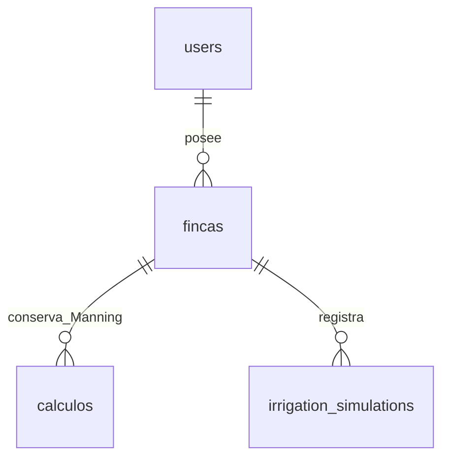

# R2A — Diseño del modelo de datos de riego por surcos

Fecha: 2026-10-12. Estado actual: migration ejecutada en R2C-2, batch 4; correctivo UTC certificado en R2C-3 (§21). Los checkpoints previos conservan su alcance histórico. B01:B20 sustituyen las recomendaciones anteriores sobre los mismos puntos.

## 0. Alcance, decisiones y evidencia

Fuente funcional: [irrigation-model.md](irrigation-model.md), decisiones aprobadas A01:A10. Fuente oficial del modelo: SHA-256 `42592487E6E07DEB1B25A073D74086A09C1BB19CB38411AAFC31D28EA64D2127`; no guardar la ruta local del archivo en las simulaciones.

Contexto R0 aportado y certificado antes de esta fase: nueva `defaultdb`, MySQL 8.4.11, TLS 1.3, sin tablas ni historial Knex; no hay datos de la base anterior que trasladar. R2A no abrió conexiones a DB ni volvió a certificar su estado.

Estado Git inicial: rama `feature/riego-surcos-v1`; únicamente `?? docs/irrigation-model.md`, trabajo previo conservado. Knex instalado: 3.1.0; mysql2 instalado: 3.24.4 (el manifiesto admite `^3.15.2`). No se cambiaron dependencias.

Se inspeccionaron las tres migrations, configuración Knex, rutas de fincas/cálculos y middleware de autenticación. Se compiló en memoria el SQL de las migrations históricas con Knex 3.1.0 y cliente mysql2, mediante `toSQL()`; no se ejecutó SQL ni se creó una migration nueva. La compatibilidad del diseño se contrastó con documentación oficial, con los límites de §17.

Decisiones del diseño R2A, aprobadas en R2B salvo sustitución explícita de la política de borrado:

| ID | Recomendación | Motivo |
| --- | --- | --- |
| R2-01 | Historia única: tres migrations históricas intactas más una nueva | Compatibilidad y trazabilidad sin duplicar users/fincas ni retirar Manning |
| R2-02 | Reutilizar users/fincas sin cambios de esquema | Ya existe propiedad usuario→finca y PK compatibles |
| R2-03 | Una tabla irrigation_simulations, sin tablas auxiliares | Una simulación es un snapshot completo de un evento por surco |
| R2-04 | Columnas para 15 inputs, 14 outputs y claves de versión; JSON para metadata y diagnósticos | Consultas habituales simples y extensibilidad acotada |
| R2-05 | DOUBLE sin escala para magnitudes numéricas calculadas con JS Number | No imponer un redondeo decimal adicional al snapshot |
| R2-06 | Guardar solo estimaciones completas que pasan controles de entrada/dominio/consistencia | Errores no crean simulaciones; sin estados persistidos innecesarios |
| R2-07 | Inputs, outputs, nombre, versiones y diagnósticos inmutables | Recalcular crea una fila nueva, preservando lo consultado históricamente |
| R2-08 | FK a finca con ON DELETE RESTRICT y ON UPDATE RESTRICT | B16 prohíbe CASCADE y preserva la finca mientras existan simulaciones; integración de borrado pendiente en §13 |
| R2-09 | created_at UTC y sin updated_at | No hay actualizaciones de snapshots en MVP |

Obligaciones A01:A10: textura nunca autocompleta CC/PMP; sin cola, N ni totales por hectárea; sin «días adicionales»; infiltración y eficiencia son estimaciones; inconsistencia no se normaliza ni recorta; precisión completa de Number y redondeo solo de presentación; versión y datos de reproducción en cada simulación guardada.

No se resuelve aquí ancho/separación, base gravimétrica/volumétrica, calibración, eficiencia agronómica, Qmax extremo, fronteras de avance ni balance hídrico. Diseñar almacenamiento no valida esas fórmulas. No se implementan motor, endpoints o frontend.

### Decisiones obligatorias R2B

| ID | Decisión registrada |
| --- | --- |
| B01 | Mantener las tres migrations históricas intactas |
| B02 | Añadir exactamente una migration: 20261012000000_create_irrigation_simulations.js |
| B03 | No eliminar ni modificar calculos |
| B04 | users y fincas permanecen sin cambios |
| B05 | Snapshot inmutable; comportamiento de aplicación futura, sin trigger de mutabilidad nuevo |
| B06 | Sin updated_at |
| B07 | name opcional e inmutable, VARCHAR(255) NULL |
| B08 | Persistir los 15 inputs efectivos del MVP; textura descriptiva nullable según R2A |
| B09 | Persistir los 14 outputs aprobados, todos NOT NULL |
| B10 | Columnas estables y model_metadata JSON |
| B11 | diagnostics JSON estructurado |
| B12 | Input inválido no genera fila; validación de aplicación futura y defensas CHECK |
| B13 | Inconsistencia física/modelo no se guarda como simulación válida; sin recortes; criterio de admisión de §11 |
| B14 | DOUBLE provisional sin escala para las 28 magnitudes Number |
| B15 | Round-trip DOUBLE pendiente de certificación real |
| B16 | FK finca_id ON DELETE RESTRICT, ON UPDATE RESTRICT; NO CASCADE |
| B17 | Índice (finca_id, created_at, id) |
| B18 | id INT UNSIGNED AUTO_INCREMENT |
| B19 | Ownership futuro usuario→finca→simulación, no garantizado solo por FK |
| B20 | No cambios de frontend, motor, routes, Manning ni DB |

Inicialización futura de aplicación: proporcionar todos los valores NN, created_at UTC, versiones y hash; model_metadata como objeto completo conforme al contrato y diagnostics como array evaluado (incluido [] sin hallazgos). Sin defaults JSON/numéricos ni objetos vacíos para esconder datos de reproducción faltantes. No hay implementación de esa escritura en R2B.

## 1. Historia real de migrations

Orden cronológico y lexicográfico actual en `db/migrations/`:

| Migration existente | up declarado | down declarado | Dependencia |
| --- | --- | --- | --- |
| 20251021033631_create_users_table.js | Crea users y unique de email | Elimina users | Ninguna tabla de dominio previa |
| 20251112235501_create_fincas_table.js | Crea fincas y FK a users | Elimina fincas | users.id |
| 20251113003352_create_calculos_table.js | Crea calculos Manning y FK a fincas | Elimina calculos | fincas.id |

### 1.1. users

- `id`: INT UNSIGNED, NOT NULL, AUTO_INCREMENT, PRIMARY KEY.
- `nombre`, `email`, `password_hash`: VARCHAR(255) NOT NULL, sin default de dominio.
- Unique real generado: `users_email_unique(email)`.
- `created_at`, `updated_at`: TIMESTAMP NOT NULL DEFAULT CURRENT_TIMESTAMP, precisión de segundos.
- `table.timestamps(true, true)` no genera ON UPDATE CURRENT_TIMESTAMP: el código de aplicación decide cuándo actualizar updated_at.

### 1.2. fincas

- `id`: INT UNSIGNED autoincremental, PK.
- `nombre_finca`: VARCHAR(255) NOT NULL; `ubicacion`: VARCHAR(255) NULL.
- `user_id`: INT UNSIGNED NOT NULL; FK real `fincas_user_id_foreign`, hacia users.id.
- Mismos timestamps que users.
- La migration no especifica ON DELETE, ON UPDATE, engine, charset ni collation. En InnoDB, omitir acciones equivale a NO ACTION/RESTRICT. La configuración/engine efectivos de una tabla nueva deberán comprobarse después de una ejecución autorizada. [Referencia MySQL de FK](https://dev.mysql.com/doc/refman/8.4/en/create-table-foreign-keys.html).

### 1.3. calculos Manning

- `id`: INT UNSIGNED autoincremental, PK.
- `finca_id`: INT UNSIGNED NOT NULL; FK real `calculos_finca_id_foreign`, hacia fincas.id, sin acciones explícitas.
- `nombre_calculo`: VARCHAR(255), permite NULL, default «Cálculo sin nombre»; `tipo_canal`: VARCHAR(255) NOT NULL.
- Inputs: `b DECIMAL(8,4)` nullable; `h DECIMAL(8,4)` NOT NULL; `z DECIMAL(8,4)` nullable; `n DECIMAL(8,4)` NOT NULL; `S DECIMAL(10,6)` NOT NULL.
- Outputs: `A`, `P` DECIMAL(10,4) NOT NULL; `Q_m3s` DECIMAL(12,6) NOT NULL.
- Timestamps como users/fincas. No CHECK geométricos declarados.
- Nombres `S`, `A`, `P`, `Q_m3s` y naming en español son históricos: no renombrarlos ni cambiar su precisión en R2A.

### 1.4. Comportamiento de aplicación observado

`src/routes/fincas.routes.js` obtiene usuario desde `req.user.userId`. Para borrar finca: comprueba `{id,user_id}`, elimina explícitamente sus calculos y luego la finca. Las dos eliminaciones no están envueltas en una transacción. **El borrado de Manning es de aplicación, no una cascada declarada en DB.**

`src/routes/calculos.routes.js` comprueba finca/propietario antes de crear o listar cálculos; consulta por finca con created_at DESC. Lectura para editar/borrar un cálculo usa join con fincas y filtro de propietario. Se permite renombrar Manning y modificar su updated_at; esa mutabilidad histórica no se traslada al nuevo snapshot.

No existe borrado de usuarios en las rutas inspeccionadas. No inferir una cascada user→fincas ni una política de transferencia de finca.

## 2. Comparación de historia y baseline

| Criterio | A: historia existente más nueva migration | B: baseline independiente para nueva DB |
| --- | --- | --- |
| Trazabilidad | Conserva nombres, orden y contratos reales, incluidos Manning | Conserva archivos viejos solo si se separan y documentan; nueva historia tiene otra identidad |
| Riesgo | Crea calculos aunque surcos no lo use; ningún contrato actual queda sin tabla | Si se excluye calculos, rutas Manning y borrado actual de finca consultan una tabla ausente |
| Mantenibilidad | Un directorio y una secuencia; sin duplicar users/fincas | Dos historias y posible deriva de entidades compartidas |
| Knex | Directorio actual, tracking por nombres y validación de lista intactos | Necesita directorio/configuración o migrationSource explícita por entorno; nunca mezclar baseline y originales que crean las mismas tablas |
| Desarrollo futuro | Nueva migration aditiva; pueden coexistir ambos dominios | Requiere decidir cómo evolucionan ramas/entornos baselined frente a históricos |
| Rollback | Quitar nueva tabla antes de fincas/users; último batch debe estar acotado | Rollback distinto por historia; no se puede cambiar directorio de una DB migrada como si fuese equivalente |
| Base nueva | No hay datos ni necesidad de transformar registros previos | Baseline más corta solo si se omite legado, con costo de compatibilidad |

**Recomendación: A.** Incorporar una única migration futura aditiva. No retirar ni eliminar calculos del esquema o código en este plan. «Retirar del producto activo» sería una decisión posterior de navegación/uso, no una condición de creación de irrigation_simulations. El costo de una tabla Manning vacía es menor que mantener dos historias y romper código existente.

Construcción limpia: users → fincas → calculos → irrigation_simulations, con los originales intactos. No editar, mover o renombrar archivos históricos; no introducir otra creación de users/fincas; no falsear filas de knex_migrations ni desactivar su validación de lista. Tracking por defecto: knex_migrations y knex_migrations_lock; se crean por Knex en la ejecución futura autorizada, no manualmente. [Configuración de migrations Knex](https://knexjs.org/guide/migrations.html).

La estrategia B sigue siendo técnicamente posible para una línea de producto realmente independiente, con directorios y contratos separados. No se justifica en este MVP.

## 3. Entidades reutilizadas y ER conceptual

users y fincas se reutilizan **sin modificaciones de migrations**. No requieren columnas específicas de cultivo, textura, geometría o riego: esos valores pueden cambiar entre simulaciones de una misma finca y deben pertenecer al snapshot.



Propiedad de irrigation_simulations siempre derivada de fincas.user_id. No duplicar user_id en cada simulación, porque podría contradecir la finca. No hay relaciones nuevas entre Manning y surcos; ninguna conversión automática de un cálculo histórico.

IDs: mantener INT UNSIGNED autoincremental, igual que las entidades existentes. UUID no aporta valor suficiente en un servidor/base pequeña sin sincronización offline o múltiples escritores independientes; añade tamaño y complejidad de índices. El ID no es autorización. INT UNSIGNED tiene rango entero representable exactamente en JS Number; no adoptar BIGINT y problemas de serialización sin necesidad.

## 4. Esquema propuesto: reglas generales

Una tabla `irrigation_simulations`, 38 columnas propuestas: 9 de identidad/presentación/reproducción, 15 inputs (14 números y textura), 14 outputs. InnoDB explícito. Texto nuevo utf8mb4; source_hash ASCII con collation ascii_bin. No cambiar engine/charset de entidades existentes en R2A.

En las tablas siguientes:

- **NN** = NOT NULL. **NULL** = ausencia permitida, sin sustitución por cero.
- **Sin default** = el servidor debe suministrar el valor; no se declaran defaults SQL de dominio. Para campos NULL, la omisión representa SQL NULL.
- **DOUBLE** = 8 bytes, binario de doble precisión, sin `(M,D)` ni escala decimal fija. Política de precisión en §10.
- Restricciones **DB** son propuestas para una futura migration; las validaciones **APP** pertenecen a una fase futura de motor/servicio. No hay implementación en R2A.
- Restricciones de dominio provienen de las propuestas documentadas en R1; no establecen rangos agronómicos óptimos. Siguen sujetas a aprobación del diseño.

## 5. Identidad, nombre, timestamps y reproducción

| Columna SQL | Tipo / precisión | Null | Default | Constraint / validación | Motivo |
| --- | --- | --- | --- | --- | --- |
| id | INT UNSIGNED | NN | AUTO_INCREMENT | PK; no CHECK sobre columna autoincremental | Identidad simple y compatible |
| finca_id | INT UNSIGNED | NN | Sin default | FK §13; no CHECK adicional en esta columna | Pertenencia obligatoria |
| name | VARCHAR(255), utf8mb4 | NULL | Sin default | APP: si existe, trim, no vacío, ≤255 caracteres | Nombre opcional elegido al crear; no afecta cálculo |
| created_at | DATETIME(3), milisegundos | NN | Sin default | APP: UTC generado por servidor al guardar; no fecha del cliente | Orden y auditoría del snapshot |
| model_version | VARCHAR(64), utf8mb4 | NN | Sin default | APP: identificador no vacío de versión inmutable registrada | A10; no reinterpretar resultados con versión actual |
| source_hash | CHAR(64), ASCII, ascii_bin | NN | Sin default | DB longitud 64; APP hexadecimal SHA-256 normalizado a minúsculas | Procedencia sin ruta local ni secreto |
| contract_version | VARCHAR(32), utf8mb4 | NN | Sin default | APP: versión no vacía de estructura/unidades | Distingue formato de la versión científica |
| model_metadata | JSON | NN | Sin default | DB: JSON_TYPE=OBJECT; APP: esquema versionado de §8 | Parámetros, unidades, supuestos, referencias inmutables |
| diagnostics | JSON | NN | Sin default | DB: JSON_TYPE=ARRAY; APP: esquema de §9 | Snapshot de reglas/evidencia; [] explícito si no hay diagnósticos |

No updated_at: no se editarán inputs, outputs, metadata, diagnósticos ni nombre en MVP. Para otra ejecución se crea otra simulación. No columna status con un único valor posible: el criterio de admisión se define en §11.

created_at mide momento de guardado, no fecha agronómica del evento (input ausente en R1). DATETIME(3) no almacena zona: la conexión compartida mysql2/Knex usa explícitamente `timezone: "Z"` desde R2C-3 y conserva el reloj UTC al escribir/leer Date. Emitir fechas API ISO con Z; la presentación local corresponde al consumidor/frontend. Sin default SQL para este snapshot; el servidor debe suministrar la fecha. La precisión de 3 fracciones es suficiente para Date de JS; id desempata. Política certificada realmente en §21, sin cambiar schema. [Precisión temporal MySQL](https://dev.mysql.com/doc/refman/8.4/en/fractional-seconds.html).

## 6. Input snapshot completo del MVP

Todos los valores representan **inputs efectivos canónicos**, antes de formateo visual. La entrada no se reconstruye desde la finca, desde el perfil actual de suelo ni desde diagnósticos. Se conservan porcentajes numéricos (por ejemplo f=60, pendiente=0.30), no sus fracciones internas (0.6, 0.003).

| Nombre R1 | Columna SQL | Unidad | Tipo / precisión | Null | Default | Constraint / validación propuesta | Motivo |
| --- | --- | --- | --- | --- | --- | --- | --- |
| crop.etoMmPerDay | eto_mm_per_day | mm/día | DOUBLE | NN | Sin default | DB ≥0; APP finito | Demanda de ese escenario |
| crop.cropCoefficient | crop_coefficient | 1 | DOUBLE | NN | Sin default | DB ≥0; no máximo 1 inventado; APP finito | Kc efectivo independiente de catálogo |
| crop.daysWithoutIrrigation | days_without_irrigation | días | DOUBLE | NN | Sin default | DB ≥0; APP finito; permite fracciones en almacenamiento, admisión funcional pendiente | No imponer entero sin decisión |
| soil.texture | texture | etiqueta | VARCHAR(64), utf8mb4 | NULL | Sin default | APP no vacío si presente; ninguna FK ni selección de CC/PMP | Información descriptiva; no consumidor aritmético demostrado |
| soil.fieldCapacityPct | field_capacity_pct | % | DOUBLE | NN | Sin default | DB 0≤PMP<CC≤100, junto a wilting_point_pct | Valor efectivo; base hídrica en metadata |
| soil.wiltingPointPct | wilting_point_pct | % | DOUBLE | NN | Sin default | DB 0≤PMP<CC≤100 | No inferirlo de textura |
| soil.bulkDensityGcm3 | bulk_density_g_cm3 | g/cm³ | DOUBLE | NN | Sin default | DB >0; APP finito | Conversión de almacenamiento sin cambio de unidad |
| soil.rootDepthM | root_depth_m | m | DOUBLE | NN | Sin default | DB >0; APP finito | Profundidad efectiva de raíces |
| soil.depletionThresholdPct | depletion_threshold_pct | % | DOUBLE | NN | Sin default | DB >0 y ≤100; APP finito | f canónico, sin persistir fracción duplicada |
| furrow.widthM | width_m | m | DOUBLE | NN | Sin default | DB >0; APP finito | Guardar valor sin resolver ancho/separación; semántica en metadata |
| furrow.lengthM | length_m | m | DOUBLE | NN | Sin default | DB >0; APP finito | Longitud del escenario, sin asumir 100 m |
| furrow.slopePct | slope_pct | % | DOUBLE | NN | Sin default | DB ≥0; sin máximo agronómico; APP finito | No confundir con S histórico de Manning |
| irrigation.flowLps | flow_lps | L/s | DOUBLE | NN | Sin default | DB >0; APP finito | Caudal efectivo por surco |
| irrigation.durationMin | duration_min | min | DOUBLE | NN | Sin default | DB >0; APP finito | Una única unidad de tiempo total |
| irrigation.advanceTimeMin | advance_time_min | min | DOUBLE | NN | Sin default | DB ≥0 y ≤duration_min; APP finito | Dominio temporal completo; igualdad permitida |

No campos runoff_l, declared_furrows_per_ha, hectárea o legacy_duration_hours. No defaults a valores de la planilla para inputs faltantes. Textura nullable representa que no se informó, no un perfil automático. Si una versión futura la hace obligatoria, debe versionar ese contrato sin cambiar retrospectivamente las filas.

## 7. Output snapshot: persistir frente a recalcular

**Recomendación: persistir los 14 resultados del MVP, sin redondeo de aplicación, en la misma inserción que inputs/metadata/diagnósticos.** Hay motivos históricos distintos para cada resultado, no solo comodidad de lectura. Un informe guardado devuelve su snapshot; recalcular con la última versión produciría otro escenario. El cálculo con la versión antigua es una comprobación opcional y no sobrescribe el original.

Todas las columnas: DOUBLE, NN, sin default. Se necesitan resultados completos para admitir una fila; no NULL para ocultar un error de cálculo.

| Resultado R1 / columna SQL | Unidad | Restricción DB propuesta | PERSISTIR: motivo histórico | RECALCULAR: uso permitido |
| --- | --- | --- | --- | --- |
| targetDepthMm / target_depth_mm | mm | ≥0 | Congela demanda mostrada con supuestos de esa versión | Verificar demanda con misma versión e inputs; otro modelo hídrico crea nueva fila |
| availableWaterMm / available_water_mm | mm | >0 | Su significado depende de base CC/PMP y versión | Auditoría con base/algoritmo archivados; no usar catálogo vigente |
| availableCapacityL / available_capacity_l | L | >0 | Depende de AU y semántica de width_m | Verificación; no solo derivar de un nuevo significado de ancho |
| maxRecommendedDepthMm / max_recommended_depth_mm | mm | >0 | Congela umbral/dosis interpretada entonces | Auditoría, sin cambiar f/criterio histórico |
| maxRecommendedVolumeL / max_recommended_volume_l | L | >0 | Volumen recomendado puede reinterpretarse neto/bruto | Verificación con la semántica registrada |
| appliedVolumeL / applied_volume_l | L | >0 | Valor de aplicación presentado, base del balance | Aunque simple, recalcular solo como control de snapshot completo, no sustitución del informe |
| infiltratedDepthStartMm / infiltrated_depth_start_mm | mm | ≥0 | Estimación dependiente de coeficientes/calibración y oportunidad temporal | Recalcular solo con parámetros históricos, nunca textura actual |
| infiltratedDepthMiddleMm / infiltrated_depth_middle_mm | mm | ≥0 | Guarda aproximación temporal/espacial de esa versión | Auditoría del mismo modelo; no integrar una curva nueva sobre esta fila |
| infiltratedDepthEndMm / infiltrated_depth_end_mm | mm | ≥0 | Es evidencia principal del déficit frente a meta al final | Auditoría del mismo modelo; cambios de avance/calibración crean fila nueva |
| estimatedUsefulVolumeL / estimated_useful_volume_l | L | ≥0 y ≤applied_volume_l | Semántica e integración aún pendientes; no reinterpretar históricamente | Auditoría con fórmula/semántica archivadas |
| residualLossVolumeL / residual_loss_volume_l | L | ≥0 | Residual mostrado no es medición de pérdidas por causa | Verificar balance numérico, sin repartirlo entre causas nuevas |
| applicationEfficiencyPct / application_efficiency_pct | % | 0≤valor≤100 | Eficiencia estimada y criterios pueden cambiar | Comprobación con versión histórica, no normalizar ni recortar |
| advanceRatioPct / advance_ratio_pct | % | 0≤valor≤100 | Guarda magnitud usada por diagnóstico original | Verificación con tiempos; nuevas bandas solo en nueva evaluación |
| maxNonErosiveFlowLps / max_non_erosive_flow_lps | L/s | >0 | Límite depende de regla/versionado/calibración futura | Auditoría con esa regla; no actualizar filas por nuevas tablas |

Los controles comparan magnitudes para evitar inconsistencias manifiestas; no prueban que la estimación coincida con el campo. Avisos de déficit respecto a meta, exceso respecto a umbral o caudal sobre Qmax pueden acompañar una estimación guardada si no existe error fatal: son la finalidad del simulador, no fallos de tipado.

No guardar conversiones L→m³, min→h ni porcentajes→fracciones duplicadas; se derivan en presentación usando el contrato archivado. Tampoco guardar rótulos didácticos. Snapshot físico y recálculo histórico no garantizan identidad bit a bit entre runtimes distintos; comparar con la tolerancia aprobada para verificación, sin convertirla en criterio de recorte o permiso para un resultado imposible.

## 8. Reproducibilidad A10

### 8.1. Columnas frente a JSON

| Estrategia | Ventajas | Costos / riesgo | Decisión |
| --- | --- | --- | --- |
| A: todas las propiedades en columnas | Tipos/constraints/consultas directas | Cada supuesto/calibración futura requiere esquema y campos aún no definidos | No para metadata variable; sí para inputs, outputs y claves de versión |
| B: todo en JSON | Snapshot extensible | Consultas y restricciones habituales más difíciles; igualdad entre contrato y datos depende de validación; índices adicionales si crece | No como contenedor único |
| C: híbrida | Columnas estables consultables + metadata versionada extensible | Exige esquema APP del JSON y evitar duplicar autoridades | **Recomendada**, 38 columnas y ningún catálogo auxiliar nuevo |

MySQL 8.4 tiene JSON nativo y valida la sintaxis del documento; eso no valida el contrato de sus claves. JSON no se indexa directamente como columna: si en el futuro se justifica buscar por una clave, evaluar columna extraída/indexada. No añadirla preventivamente. [JSON MySQL](https://dev.mysql.com/doc/refman/8.4/en/json.html).

### 8.2. Contenido requerido de model_metadata

| Sección conceptual | Contenido / política |
| --- | --- |
| metadata_schema_version | Identificador de estructura del JSON, distinto de model_version/contract_version |
| effective_parameters | Valores efectivos que afectan cálculo/diagnóstico: coeficientes y exponente, factor de llegada media, constantes Qmax/rama cero si se usan, criterios de balance y bandas de avance efectivamente seleccionadas, con unidades y versión de regla |
| units | Mapa canónico de campos: mm, m, %, L/s, min, L, mm/día, días, g/cm³ y coeficientes adimensionales; convención de % vs fracción explícita |
| assumptions | ETo/Kc constantes, caudal constante, alcance sin lluvia/humedad inicial, semántica de ancho, base CC/PMP, aproximación de avance/infiltración y significado de residual/eficiencia tal como esa versión los declara |
| evidence_state | Estado explícito de estimación/calibración; ninguna etiqueta agronómicamente validada por defecto. Pendientes se registran como pendientes, sin inferir valores |
| reference_versions | catalog_version/calibration_version o null explícito cuando no existen/no se usan; si se usan, valores efectivos o referencias inmutables archivadas, nunca solo puntero a catálogo mutable |
| implementation_reference | Identificador/digest de implementación archivada y, cuando afecte reproducción, runtime/convención numérica; no rutas locales ni credenciales |

Los números de R1 (por ejemplo k=4.5, exponente=0.5) son evidencia literal, no calibración aprobada. Registrarlos si la versión autorizada los usa; no llenar metadata con una decisión ficticia sobre width_m, humedad o umbrales. Una versión que conserva una ambigüedad debe identificar su alcance y no emitir un diagnóstico definitivo que requiera resolverla.

No duplicar inputs y outputs en JSON: sus columnas son autoridad. No duplicar claves model_version/source_hash/contract_version dentro de metadata como otra fuente editable. Los parámetros transversales sí pertenecen al JSON. Una inconsistencia entre metadata y contrato debe impedir guardar, no seleccionar la interpretación más conveniente.

Un model_version debe referir una definición inmutable y recuperable. Si cambia una fórmula, orden operativo relevante, coeficiente, semántica o regla, cambiar versión y crear otra simulación. El hash de Excel identifica el insumo documental; **no identifica por sí solo el algoritmo ejecutable**. Guardar inputs + source_hash sin conservar implementación/versiones efectivas no satisface reproducción futura. La estrategia de archivado se concretará al implementar/publicar el motor, sin commits en R2A.

## 9. Diagnósticos: comparación y diseño

| Opción | Reproducibilidad | Consultas / costo | Recomendación |
| --- | --- | --- | --- |
| A: JSON diagnostics en la fila | Preserva evaluación original junto con snapshot | Lectura por finca simple; búsqueda masiva por regla más costosa | **Sí**, menor complejidad para MVP |
| B: irrigation_simulation_diagnostics | Reglas buscables/indexables y posible crecimiento independiente | Más tablas, relaciones y escritura; no hay uso masivo aprobado | No en MVP; reevaluar con necesidad concreta |
| C: recalcular siempre | Cambios de umbral/mensaje/versiones alteran informe | Requiere conservar motor antiguo para cada lectura | No como fuente del diagnóstico histórico |

Cada elemento JSON conservará:

- `id`: stable ID de la regla, no UUID del evento; identificadores de R1 son propuestas hasta formalización de reglas.
- `rule_version`: versión inmutable de esa regla.
- `severity`: vocabulario del contrato (propuesta: info/warning/error), no inferido desde un mensaje.
- `fields`: lista de rutas canónicas afectadas, por ejemplo irrigation.flowLps.
- `evidence`: magnitudes sin redondeo, unidades, operador/criterio y referencia/estado de evidencia que justificaron el resultado.
- `message`: opcional, texto presentado originalmente; no usarlo como clave de negocio.

El conjunto y sus versiones también deben corresponder a metadata. APP valida cada elemento y límites estructurales del payload; DB solo exige array JSON. [] indica evaluación realizada sin diagnósticos, no «no se evaluó». Regla no validada debe quedar sin interpretación definitiva o expresarse como advertencia de evidencia pendiente, según el contrato de esa versión.

Por §11, diagnósticos de error fatal de input/dominio/inconsistencia se devuelven sin guardar fila; los snapshots admitidos pueden contener info/warning. No añadir bitácora de intentos ni guardar payloads inválidos en metadata. Cambiar un texto de presentación en el futuro no reescribe evidencia histórica.

## 10. Tipos y precisión: DECIMAL frente a DOUBLE

`DECIMAL(p,s)` representa decimales exactos con escala fijada; es apropiado cuando el contrato exige un quantum decimal exacto (por ejemplo un importe monetario o una medición regulada). Una escala arbitraria también cuantiza valores de más precisión. Este modelo no tiene dinero ni resolución instrumental aprobada. [DECIMAL MySQL](https://dev.mysql.com/doc/refman/8.4/en/fixed-point-types.html).

JS Number utiliza binario IEEE-754 de 64 bits, con aproximadamente 15–17 dígitos significativos, no exactitud decimal universal. La raíz y las operaciones del motor seguirán usando Number: aumentar la escala SQL no recupera precisión que el motor nunca produjo. [Number, MDN](https://developer.mozilla.org/en-US/docs/Web/JavaScript/Reference/Global_Objects/Number).

DOUBLE MySQL ocupa 8 bytes; no declarar `(M,D)`, que añade redondeo y cuya sintaxis está deprecada. Es una elección coherente con el valor numérico efectivo de Number, no una promesa de exactitud decimal. [DOUBLE MySQL](https://dev.mysql.com/doc/refman/8.4/en/floating-point-types.html).

| Magnitud | DECIMAL: cuándo tendría sentido | Propuesta MVP | Razón |
| --- | --- | --- | --- |
| Porcentajes | Escala explícita aprobada del instrumento/contrato | DOUBLE | CC/PMP/f/avance/eficiencia no tienen resolución aprobada; preservar valor efectivo sin forzar dos decimales |
| mm | Resolución medida contractual | DOUBLE | Láminas estimadas con raíces/coeficientes; 1 o 2 decimales del Excel son presentación |
| Metros | Medición con paso exacto obligatorio | DOUBLE | No imponer escala de largo/ancho/profundidad por inferencia |
| L/s | Precisión instrumental acordada | DOUBLE | Caudal/Qmax de cálculo y casos de pendiente baja no comparten escala fija |
| Minutos/días | Tiempo discreto contractual | DOUBLE | Duraciones y avance fraccionales; días admite almacenamiento sin decidir aceptación de fracciones |
| Litros | Contabilidad decimal exacta aprobada | DOUBLE | Derivados de área/lámina; no hay requisito contable |
| Coeficientes/densidad | Serie de decimales contractualmente exacta y aritmética decimal | DOUBLE | Coeficientes efectivos con Number; no introducir otra biblioteca numérica |

El input efectivo `0.1` ya es un Number binario; este diseño preserva su valor efectivo, no la cadena original «0,100» ni ceros finales. Si se necesita reproducir la transcripción literal o usar aritmética decimal, eso requiere una decisión de contrato/motor distinta. No es necesario para A10 bajo el motor Number especificado.

APP debe validar Number.isFinite para todas las magnitudes **antes de serializar JSON**: NaN/Infinity no deben convertirse a null ni persistirse. No usar toFixed/round intermedios, no activar una opción mysql2 que convierta valores truncados y no calcular outputs históricos con SQL. El futuro ensayo autorizado debe probar ida/vuelta Node→mysql2→DOUBLE→Node y metadata JSON, incluyendo valores no enteros y casos golden; esa fidelidad no fue certificada en DB en R2A.

DB checks propuestos son límites, no identidades algebraicas aproximadas. No imponer igualdad exacta entre litros derivados para comparar fórmulas de punto flotante; controles de coherencia completos corresponden al motor versionado. Tampoco usar la tolerancia numérica de golden para permitir η>100 o recortar un volumen: si la versión detecta inconsistencia, reportar error. No fijar tolerancias físicas nuevas sin aprobación.

## 11. Estado, admisión y lifecycle

| Alternativa | Beneficio | Costo / límite |
| --- | --- | --- |
| Persistir intentos de input inválido | Podría servir a auditoría de intentos | No es historial de simulación; requiere schema distinto, campos opcionales y retención; necesidad no aprobada |
| Persistir inconsistencia con estado explícito | Conserva evidencia para investigación | Mezcla fallos con historial, requiere outputs parciales/nullables, filtros seguros y UX adicional |
| No guardar errores/ inconsistencias; solo snapshots completos consistentes | Tabla simple, NN en resultados, imposible confundir fila guardada con intento fallido en el flujo autorizado | No conserva evidencia de fallo en DB; devolverla al usuario sin ID |

**Recomendación: tercera opción.** No columna status ni tabla de errores. No guardar input inválido, fallo de dominio, resultado no finito o inconsistencia física/modelo. Devolver código/diagnósticos/evidencia de error sin simulation_id; no insertar fila para luego marcarla inválida. El protocolo concreto se define al implementar endpoints, no aquí.

Una fila guardada representa **estimación numéricamente consistente bajo una versión y sus controles**, no simulación agronómicamente validada. metadata.evidence_state y supuestos conservan esa distinción. La aprobación de R1 no autoriza marcar calibration validated.

Lifecycle conceptual: autorización user→finca → validación de inputs → cálculo autorizado → controles de finitud/dominio/consistencia → metadata/diagnósticos → una inserción completa. Si falta output, dato de reproducción o regla necesaria, no guardar un snapshot incompleto. Si se usa una versión experimental explícita, registrar sus pendientes y no certificarla como validada por campo.

G12 de R1 (η cercana a 740 %, residual negativo): respuesta de inconsistencia sin fila, sin normalización ni recorte. G09 (avance mayor que duración): error de input/dominio sin fila. G01 puede generar avisos de meta/umbral y conservarse solo bajo un contrato de estimación autorizado; R2A no habilita todavía ese motor.

Los checks DB de useful≤applied, pérdidas≥0 y eficiencia≤100 son defensas adicionales contra persistencia accidental imposible. No contienen el balance completo ni convierten a la DB en motor. No almacenar simulaciones científicamente certificadas por defecto solo porque pasan esos checks.

## 12. Inmutabilidad y nombre

Crear simulación → snapshot inmutable. No editar inputs históricos ni renombrar fila en MVP; name se decide opcionalmente al crear. Recalcular o cambiar un input produce nueva fila y nueva evaluación bajo la versión elegida. No agregar parent_simulation_id hasta que exista funcionalidad de comparación/linaje requerida.

Ventajas: informes estables, auditoría de cada decisión, reproducibilidad de reglas y ausencia de cambios retroactivos por catálogos. Desventajas: más filas si se recalcula, nombres no corregibles después de guardar y eventual repetición de inputs; aceptable para este proyecto pequeño. Permitir renombrar en el futuro sería una modificación explícita del lifecycle y requeriría separar metadata mutable o revisar updated_at.

Sin triggers de inmutabilidad ni permisos de DB nuevos en R2A: es un contrato para las futuras escrituras autorizadas, no una protección ya implementada. Administradores siguen pudiendo modificar una DB; no prometer auditoría a prueba de manipulación.

Inmutabilidad de valores no implica retención perpetua. B16 impide eliminar una finca con simulaciones mediante FK RESTRICT. Una política futura de borrado explícito de snapshots requeriría autorización; down elimina la tabla y sus datos. Ninguna actualización de fórmula debe reescribir snapshots.

## 13. FK, borrados e índices

FK escrita `irrigation_simulations_finca_id_foreign`: finca_id INT UNSIGNED NN → fincas.id INT UNSIGNED PK; ON DELETE RESTRICT, ON UPDATE RESTRICT, según B16. No FK directa a users, no tablas referenciadas por JSON.

### 13.1. Comparación de políticas de borrado

| Política | Impacto en snapshots | Impacto en aplicación existente | Decisión |
| --- | --- | --- | --- |
| CASCADE | Borrar finca elimina permanentemente todas sus nuevas simulaciones | El DELETE actual podría borrar calculos y finca sin nuevos hijos huérfanos | Recomendación original R2A descartada explícitamente por B16; no escrita |
| RESTRICT | Impide borrar finca con simulaciones | Código actual elimina calculos primero; luego falla al borrar finca y puede perder historia Manning antes del error porque no hay transacción | **Aprobada por B16**; integración futura debe contemplar precheck/transacción antes de habilitar guardados |
| Soft-delete | Preserva snapshots y finca oculta | Requiere columna nueva, filtros en todas las consultas y decisiones de restauración/ownership | Fuera del MVP; podría evaluarse si la retención se vuelve requisito |
| Copiar eliminación manual actual para nuevos hijos, FK RESTRICT | El borrado explícito también elimina snapshots | Exige modificar ruta/transacción y depende de todas las rutas de eliminación | Más código futuro que cascade para el mismo resultado de retención |

No se cambia fincas.user_id: borrar usuario con fincas seguirá restringido en InnoDB. No se cambia FK de calculos ni se elimina Manning. La nueva FK no contiene CASCADE.

Antes de activar guardados de simulaciones, el flujo de borrado debe tratar la restricción y preservar Manning ante un rechazo: comprobar dependencias y usar una transacción que revierta eliminaciones previas si la FK impide borrar finca. Hoy podría borrarse Manning y fallar luego. Esta integración es trabajo posterior con autorización; B20 prohíbe modificar routes en R2B. El riesgo queda documentado, no corregido por la sola FK.

### 13.2. Índices mínimos

| Índice propuesto | Columnas | Uso |
| --- | --- | --- |
| PRIMARY | id | Acceso a snapshot individual seguido siempre de ownership |
| irrigation_simulations_finca_created_id_idx | finca_id, created_at, id (BTREE, orden ASC físico convencional) | Historial filtrado por finca, consulta created_at DESC, id DESC; recorrido inverso, desempate estable |

El índice compuesto comienza por finca_id y cubre la necesidad de índice de FK; no agregar además un índice simple redundante de finca_id. No índices iniciales por textura, outputs, JSON, name o versión: no hay consulta específica aprobada. fincas.id ya es PK, y la FK user_id requiere índice compatible en InnoDB; no añadir índice duplicado en entidades históricas por inferencia.

Consulta esperada: finca verificada del usuario; historial limitado/paginado con fecha DESC e id DESC. Para página siguiente, cursor de created_at e id, no solo timestamp. El plan real y la suficiencia del índice requieren EXPLAIN y datos representativos después de ejecución autorizada; no afirmar rendimiento certificado ahora. [Ordenación e índices MySQL](https://dev.mysql.com/doc/refman/8.4/en/order-by-optimization.html).

## 14. Ownership y seguridad conceptual

- Usuario efectivo proviene de autenticación verificada, no del body ni de un user_id asociado por cliente.
- Crear/listar: comprobar finca_id y fincas.user_id=usuario autenticado; crear el snapshot con esa finca, no con una finca alternativa recibida en otro campo.
- Obtener/exportar/borrar una simulación si se habilita esa acción: resolver simulation_id con join a fincas, condicionando propietario; si la ruta incluye finca_id, comprobar también coincidencia de ambos IDs.
- Nunca recuperar solo irrigation_simulations.id y darlo por autorizado. PK y FK garantizan identidad/relación, no aislamiento de usuarios.
- Inputs efectivos se validan; outputs, versiones, hash, metadata y diagnósticos los construye el servidor a partir del modelo autorizado. No aceptar outputs o model_version arbitrarios del cliente como autoridad de persistencia.
- Insertar de forma atómica el snapshot completo; resolver carreras con borrado de finca mediante transacción/ownership comprobado y FK. Si la finca desaparece no guardar huérfano ni intentar otra finca. La estrategia exacta de bloqueo se concreta después.
- FK no registra «usuario creador» histórico: propiedad actual deriva de la finca. El producto inspeccionado no permite transferencias. Si se añade transferencia, decidir acceso al historial antes de esa funcionalidad.
- Metadata/diagnósticos se construyen con campos permitidos: nunca copiar req.body, errores SQL, JWT, cookies, credenciales, rutas locales o detalles de conexión completos. Versiones/referencias de implementación no deben contener secretos.

Son requisitos de implementación futura. No hay endpoints ni cambios de autenticación en esta fase.

## 15. CHECK y validación: alcance propuesto

Agrupar condiciones en constraints nombrados menores de 64 caracteres. Inventario conceptual, sin DDL ni código de migration:

| Nombre propuesto | Condiciones |
| --- | --- |
| irr_sim_crop_ck | eto_mm_per_day≥0, crop_coefficient≥0, days_without_irrigation≥0 |
| irr_sim_soil_pct_ck | 0≤wilting_point_pct<field_capacity_pct≤100; 0<depletion_threshold_pct≤100 |
| irr_sim_soil_geometry_ck | bulk_density_g_cm3>0; root_depth_m>0 |
| irr_sim_furrow_ck | width_m>0; length_m>0; slope_pct≥0 |
| irr_sim_irrigation_ck | flow_lps>0; duration_min>0; 0≤advance_time_min≤duration_min |
| irr_sim_output_depth_ck | target_depth_mm≥0; available_water_mm>0; max_recommended_depth_mm>0; las tres láminas infiltradas≥0 |
| irr_sim_output_volume_ck | available_capacity_l>0; max_recommended_volume_l>0; applied_volume_l>0; 0≤estimated_useful_volume_l≤applied_volume_l; residual_loss_volume_l≥0 |
| irr_sim_output_ratio_ck | 0≤application_efficiency_pct≤100; 0≤advance_ratio_pct≤100; max_non_erosive_flow_lps>0 |
| irr_sim_json_ck | model_metadata es OBJECT y diagnostics es ARRAY |
| irr_sim_hash_ck | CHAR_LENGTH(source_hash)=64 |

No CHECK sobre id autoincremental ni finca_id con acciones referenciales. MySQL CHECK admite condiciones deterministas sobre la fila; no implementa aquí fórmulas ni ownership entre tablas. NOT NULL sigue siendo necesario para que ausencia no pase como condición desconocida. [Restricciones CHECK MySQL](https://dev.mysql.com/doc/refman/8.4/en/create-table-check-constraints.html).

APP: tipos estrictos, finitud, strings normalizados, hash hexadecimal, esquema JSON, listas/IDs de regla autorizados, compatibilidad de versiones, datos completos de reproducción y controles físicos versionados. Los límites porcentuales son el dominio propuesto de R1; no declaran que cualquier valor dentro del intervalo sea agronómicamente correcto. La base gravimétrica/volumétrica sigue pendiente.

No defaults numéricos cero ni metadatos `{}` silenciosos. Una constraint no sustituye A08; solo reduce errores de integración. No INSERT IGNORE para omitir fallos ni normalización de valores que no pasan los controles.

## 16. Migration plan y rollback

### 16.1. Migrations necesarias

**Exactamente una nueva migration escrita en R2B**: `db/migrations/20261012000000_create_irrigation_simulations.js`, posterior cronológicamente a 20251113003352. Mismo directorio histórico; no ejecutada.

No migrations nuevas para users/fincas, no eliminación de calculos, no migration de datos, no catálogo, no tabla de diagnósticos, no cambios de directorio/configuración, no creation de otra DB.

Plan completo para base nueva tras autorización separada de ejecución: aplicar las tres históricas en orden; verificar resultado; luego aplicar únicamente la nueva en una fase/batch identificable. Evitar que las cuatro queden en el mismo batch si se espera revertir solo surcos con rollback de último batch. El mecanismo de ejecución acotada se elegirá al ejecutar, no se proporciona un comando para correr ahora.

### 16.2. up y down de la propuesta

| Paso | Acción conceptual |
| --- | --- |
| up | Crear irrigation_simulations con 38 columnas, engine InnoDB, tipos/nulabilidad de §§5–7, checks §15, índice compuesto §13 y FK a fincas; no tocar tablas históricas ni insertar datos |
| down | Eliminar únicamente irrigation_simulations; sus constraints/índices desaparecen con la tabla; no borrar fincas, users, calculos ni metadata Knex manualmente |

down es destructivo: pierde todas las simulaciones nuevas si hay filas. No restaura una versión anterior de outputs ni recupera snapshots. Antes de autorizarlo con datos: respaldo y procedimiento de recuperación/restore comprobado. Una migration inversa no es backup.

Rollback histórico, solo si se pide reconstruir toda la base: primero nueva tabla, luego calculos, luego fincas, luego users. No ejecutar down de finca mientras existan dependencias. No confiar en CASCADE para esquivar dependencias de DROP TABLE.

MySQL DDL puede producir commits implícitos; una transacción Knex no convierte el batch completo en rollback atómico. Si una migration futura falla después de CREATE y antes de añadir constraint, revisar DDL efectivo y tracking antes de reintentar. No usar hasTable para esconder una tabla parcial ni alterar knex_migrations para forzar éxito. [Commits implícitos MySQL](https://dev.mysql.com/doc/refman/8.4/en/implicit-commit.html).

La atomicidad de una inserción de simulación con metadata/diagnósticos es otra cuestión: una fila no requiere escritura en varias tablas de snapshot. No confundir esa atomicidad con la de cambios de esquema.

## 17. Compatibilidad MySQL 8.4.11 y Knex 3.1.0

| Elemento | Evaluación estática | Límite de la evidencia |
| --- | --- | --- |
| INT UNSIGNED autoincremental / PK / FK | Tipos históricos compilados localmente; nueva FK propuesta coincide con fincas.id | Engine y constraints reales no verificados en DB en R2A |
| DOUBLE sin escala | Tipo MySQL compatible; compilador mysql de Knex 3.1.0 devuelve double cuando no se indica precisión | No certificar ida/vuelta sin ensayo autorizado |
| JSON | Tipo nativo MySQL; Knex mysql2 compila json | Validación estructural requiere APP; no metadata por default |
| CHECK | Condiciones deterministas sobre fila, con nombres explícitos y sin columnas referenciales/id; compiladas offline en R2B | No ejecutadas ni certificadas contra servidor |
| Índice compuesto | BTREE compatible; índice inicial sin sintaxis especial DESC | Rendimiento/plans pendientes |
| VARCHAR/CHAR | Longitudes y charset compatibles; hash separado en ASCII binario | No datos efectivos ni collation real comprobados |
| DATETIME(3) | Soportado; compilador local acepta precisión 3; almacenamiento y lectura UTC certificados en R2C-3 | Certificación con timezone Z y sesión MySQL UTC efectiva; conservar esa condición en despliegues |
| Defaults | NN sin default exige valores explícitos; NULL opcional; solo id autoincremental | Exigir modo estricto en entorno de prueba posterior; no se leyó sql_mode en esta fase |
| Históricos | Se generaron 6 sentencias up y 3 down en memoria, sin ejecutar | Compilación no es certificación de aplicación real |

La documentación de Schema Builder describe doubles con precisión/escala y specificType. La inspección **del Knex instalado 3.1.0** confirmó su rama DOUBLE sin parámetros, así como JSON y DATETIME(precision). Al escribir la migration futura, verificar SQL generado: debe decir DOUBLE, nunca DOUBLE(8,2) ni otra escala implícita. Si se necesita fijar el tipo inequívocamente, specificType permite hacerlo. No usar FLOAT, `.unsigned()` en DOUBLE ni precision/scale decimal para redondear snapshots. [Schema Builder Knex](https://knexjs.org/guide/schema-builder.html).

No defaults JSON para evitar reglas de expresiones y snapshots incompletos; servidor suministra objeto/array explícitos. No se requieren generated columns, triggers, funciones almacenadas ni extensiones. [Defaults MySQL](https://dev.mysql.com/doc/refman/8.4/en/data-type-defaults.html).

No se llamó a migrate.latest, migrate.list, migrate.currentVersion, migrate.rollback ni otro método de migrator: incluso una consulta de estado vía migrator podría crear tablas de control. No se importó la instancia de conexión del proyecto para validar diseño. No se hizo SELECT, DDL o DML contra Aiven.

## 18. Riesgos y puntos pendientes

| Riesgo / pendiente | Decisión o tratamiento |
| --- | --- |
| Fórmulas no validadas agronómicamente | Metadata registra estimación/pendientes; no marcar validación científica por el esquema |
| Ancho/separación y CC/PMP | Persistir valor/base declarada sin inferir; resolver antes de certificar cálculos y recomendaciones |
| Infiltración, volumen útil, residual y eficiencia | Versionar parámetros/semántica; A08 bloquea guardar resultados imposibles |
| Qmax cero/extremos y bandas 25/30/50 | Regla/versionado necesario; no construir diagnósticos definitivos con umbrales ficticios |
| Borrado RESTRICT de finca | Aprobado B16; impide borrar finca con simulaciones. Riesgo de borrado previo de Manning en ruta actual no transaccional |
| DELETE actual no transaccional | Puede eliminar Manning antes de un fallo; no corregido en R2A. Integración futura de borrado debe contemplarlo |
| DOUBLE y serialización | Ensayo de round-trip futuro, no prometer decimales exactos ni comparar cálculos por igualdad exacta |
| UTC con DATETIME/TIMESTAMP | timezone Z compartida y certificada en R2C-3; DATETIME no incorpora zona y TIMESTAMP depende además de sesión MySQL. Verificar UTC efectivo si cambia entorno |
| Metadata mutable o incompleta | Validación de contrato y versiones inmutables; conservar motor/versiones para reproducción |
| Batches Knex y DDL parcial | Ejecutar después por fases identificables; revisar tracking/DDL si falla; no reintentar ciegamente |
| Inmutabilidad solo contractual | No hay protección implementada ni triggers nuevos; endpoints futuros no deben actualizar snapshots |

Diseño aprobado por B01:B20: historia A, 38 columnas, DOUBLE provisional, los 14 outputs, rechazo sin guardar de errores/inconsistencias, RESTRICT sin CASCADE, snapshot inmutable con name opcional y DATETIME(3) UTC. Escritura autorizada y realizada en R2B; ejecución no autorizada.

Pendientes antes de habilitar motor: los puntos agronómicos abiertos de R1, semántica/estados de metadata, versión inicial de modelo/contrato y reglas válidas, límites funcionales de inputs (incluidos días fraccionarios), controles de consistencia y límites estructurales JSON. No se eligen por inferencia.

## 19. Verificación y cierre histórico de R2A

- Revisión estática de tres migrations, configuración y ownership/delete de rutas existentes.
- Compilación offline de SQL histórico con Knex 3.1.0: 6 sentencias up y 3 down; ninguna ejecución.
- Cobertura de 15 inputs y 14 outputs requeridos; exclusiones A03:A05 explícitas.
- Comprobación documental de 38 columnas: 9 de identidad/presentación/reproducción, 15 inputs y 14 outputs; todas las filas incluyen tipo, nulabilidad, default y restricción/motivo.
- SHA-256 de las tres migrations históricas y de docs/irrigation-model.md iguales antes/después; no hay modificaciones del contenido previo.
- Compatibilidad documental MySQL 8.4 y revisión del compilador local; sin pruebas de DB, round-trip, rendimiento o rollback real.
- Nuevo archivo único de R2A: docs/irrigation-data-model.md. Se conserva el documento R1 existente sin cambios.
- Git final en feature/riego-surcos-v1: `?? docs/irrigation-model.md` previo y `?? docs/irrigation-data-model.md` nuevo; ningún archivo tracked modificado. Revisión de espacios del nuevo documento correcta.
- No migrations nuevas o editadas, motor, endpoints, frontend, conexión DB, tablas, datos, commits o push.

**¿Está listo para escribir migrations?** El diseño es concreto y revisable; **sí como propuesta de persistencia, después de aprobar las recomendaciones de R2A y autorizar expresamente la escritura**. Las dudas agronómicas no se resuelven por crear la tabla ni se necesitan para compilar sus tipos, pero sí condicionan la admisión/calificación de futuras simulaciones. Escribir, ejecutar y habilitar el motor son autorizaciones distintas. Esta fase se detiene aquí, sin escribir archivos de migration.

## 20. R2B — Migration escrita, no ejecutada

R2A está cerrado. La autorización R2B habilitó solo escribir la migration y compilar SQL offline, además de registrar B01:B20. El checkpoint de §19 corresponde a la fase anterior, no al estado actual.

La tabla tiene 38 columnas; solamente name y texture son nullable. Las 28 columnas numéricas son DOUBLE sin escala y NN; los 14 outputs son obligatorios. Metadata/diagnósticos son JSON NN sin defaults. Se mantienen los diez CHECK del diseño y no se implementan fórmulas en SQL. El nombre de archivo posterior a las tres históricas mantiene el orden.

La migration no impone por sí sola inmutabilidad de snapshots, ownership o rechazo de cualquier input inconsistente: conserva restricciones estructurales y los controles genéricos del diseño. Esas garantías completas requieren el servicio futuro, que no se implementa aquí. La precisión real DOUBLE y el parser UTC requieren certificación posterior.

Estado de ejecución: ninguna conexión a Aiven, ningún método knex.migrate, ningún SQL manual ejecutado, ningún cambio de tablas o datos. down afecta solo irrigation_simulations y sería destructivo si se ejecuta con datos.

SQL exacto generado por Knex 3.1.0/mysql2 en memoria, sin ejecución, registrado a continuación. Compatibilidad estática no equivale a un ensayo de servidor ni de rollback.

### SQL up generado (no ejecutado)

```sql
create table `irrigation_simulations` (`id` int unsigned not null auto_increment primary key, `finca_id` int unsigned not null, `name` varchar(255) null, `eto_mm_per_day` double not null, `crop_coefficient` double not null, `days_without_irrigation` double not null, `texture` varchar(64) null, `field_capacity_pct` double not null, `wilting_point_pct` double not null, `bulk_density_g_cm3` double not null, `root_depth_m` double not null, `depletion_threshold_pct` double not null, `width_m` double not null, `length_m` double not null, `slope_pct` double not null, `flow_lps` double not null, `duration_min` double not null, `advance_time_min` double not null, `target_depth_mm` double not null, `available_water_mm` double not null, `available_capacity_l` double not null, `max_recommended_depth_mm` double not null, `max_recommended_volume_l` double not null, `applied_volume_l` double not null, `infiltrated_depth_start_mm` double not null, `infiltrated_depth_middle_mm` double not null, `infiltrated_depth_end_mm` double not null, `estimated_useful_volume_l` double not null, `residual_loss_volume_l` double not null, `application_efficiency_pct` double not null, `advance_ratio_pct` double not null, `max_non_erosive_flow_lps` double not null, `model_version` varchar(64) not null, `source_hash` char(64) character set ascii collate ascii_bin not null, `contract_version` varchar(32) not null, `model_metadata` json not null, `diagnostics` json not null, `created_at` datetime(3) not null, constraint irr_sim_crop_ck check (eto_mm_per_day >= 0 AND crop_coefficient >= 0 AND days_without_irrigation >= 0), constraint irr_sim_soil_pct_ck check (wilting_point_pct >= 0 AND field_capacity_pct > wilting_point_pct AND field_capacity_pct <= 100 AND depletion_threshold_pct > 0 AND depletion_threshold_pct <= 100), constraint irr_sim_soil_geometry_ck check (bulk_density_g_cm3 > 0 AND root_depth_m > 0), constraint irr_sim_furrow_ck check (width_m > 0 AND length_m > 0 AND slope_pct >= 0), constraint irr_sim_irrigation_ck check (flow_lps > 0 AND duration_min > 0 AND advance_time_min >= 0 AND advance_time_min <= duration_min), constraint irr_sim_output_depth_ck check (target_depth_mm >= 0 AND available_water_mm > 0 AND max_recommended_depth_mm > 0 AND infiltrated_depth_start_mm >= 0 AND infiltrated_depth_middle_mm >= 0 AND infiltrated_depth_end_mm >= 0), constraint irr_sim_output_volume_ck check (available_capacity_l > 0 AND max_recommended_volume_l > 0 AND applied_volume_l > 0 AND estimated_useful_volume_l >= 0 AND estimated_useful_volume_l <= applied_volume_l AND residual_loss_volume_l >= 0), constraint irr_sim_output_ratio_ck check (application_efficiency_pct >= 0 AND application_efficiency_pct <= 100 AND advance_ratio_pct >= 0 AND advance_ratio_pct <= 100 AND max_non_erosive_flow_lps > 0), constraint irr_sim_json_ck check (JSON_TYPE(model_metadata) = 'OBJECT' AND JSON_TYPE(diagnostics) = 'ARRAY'), constraint irr_sim_hash_ck check (CHAR_LENGTH(source_hash) = 64)) default character set utf8mb4 engine = InnoDB;

alter table `irrigation_simulations` add index `irrigation_simulations_finca_created_id_idx`(`finca_id`, `created_at`, `id`);

alter table `irrigation_simulations` add constraint `irrigation_simulations_finca_id_foreign` foreign key (`finca_id`) references `fincas` (`id`) on update RESTRICT on delete RESTRICT;
```

### SQL down generado (no ejecutado)

```sql
drop table `irrigation_simulations`;
```

Validación R2B: require y sintaxis correctos; 3 sentencias up / 1 down compiladas offline; 38 columnas distintas, 36 NN, 2 nullable (name/texture), 28 DOUBLE sin escala, 10 CHECK, FK RESTRICT e índice exactos. Hashes de las tres migrations históricas y del documento R1 intactos. SQL generado no toca otras tablas excepto la referencia FK a fincas. Ninguna ejecución de DB ni garantía round-trip certificada.

Git final R2B: única migration nueva sin seguimiento y actualización del documento R2A (que ya estaba sin seguimiento); R1 sin cambios. Ningún archivo tracked modificado, commit o push. Revisión de espacios de ambos archivos R2B correcta.

**¿Está lista para ejecutar en defaultdb?** Lista estáticamente para una ejecución futura autorizada **después de crear users/fincas/calculos con las tres migrations históricas** y comprobar esa fase. No ejecutar esta migration sola contra la base vacía: la FK requiere fincas. En R2B no se volvió a comprobar el estado de la base y no se autoriza ejecutar ni siquiera la secuencia histórica. La certificación real de schema/constraints/round-trip y la integración del borrado RESTRICT quedan para fases posteriores autorizadas.

## 21. R2C-3 — UTC corregido y certificado

### Cambio mínimo y causa raíz

Antes, la factory src/config/database.js omitía timezone y mysql2 usaba local. En Node America/Buenos_Aires, Date `2026-10-12T15:30:45.123Z` se persistía en DATETIME como `2026-10-12 12:30:45.123`; la lectura local reconstruía el ISO original y ocultaba el desplazamiento físico. R2C-3 añadió únicamente `timezone: "Z"` en getDatabaseConnection(). No offsets de Argentina, conversiones manuales, dateStrings nuevos o cambios de schema.

src/config/knex.js, knexfile.js (development/production), validación de environment y scripts/check-db-tls.js consumen la misma factory. Runtime y CLI usan Z sin duplicar configuración. Nuevas escrituras de Date son UTC; no se reescribieron migration_time históricos ni filas de tracking. IDs, nombres y batches 1–4 permanecieron intactos.

### Impacto transversal

| Área | Resultado / límite |
| --- | --- |
| irrigation_simulations.created_at | DATETIME(3) conserva reloj UTC enviado; fecha y milisegundos certificados |
| users/fincas/calculos created_at y updated_at | TIMESTAMP(0): defaults del servidor y escritura de Date UTC certificados; precisión original de segundos preservada |
| MySQL TIMESTAMP | Convierte respecto de la zona de sesión MySQL. timezone de mysql2 controla codificación/lectura del cliente y no ejecuta SET de sesión |
| MySQL DATETIME | No convierte zona en servidor; UTC se conserva por política de cliente, no por tipo SQL |
| Defaults y knex.fn.now() | Siguen siendo expresiones SQL del servidor; sesión UTC efectiva confirmada, NOW coincide con UTC_TIMESTAMP. No cambios de routes |
| Orden por created_at | SQL/orderBy existente intacto; test histórico de orden DESC sigue pasando |
| API | Routes devuelven filas mediante res.json sin conversión local ni replacer de fechas. Date serializa ISO UTC; comprobado por HTTP con DB mock y por JSON de fila real |
| Manning | Servicio y contratos intactos; fixture válido calculado por el servicio existente, sin fórmulas nuevas |
| Migrations/CLI | Archivos y hashes intactos; factory común aplica Z a futuras operaciones, sin ejecutar migrations en R2C-3 |
| TLS | TLSv1.3 y TLS_AES_256_GCM_SHA384 verificados después del cambio |

MySQL convierte TIMESTAMP entre zona de sesión y UTC, mientras DATETIME conserva el reloj sin zona. Por eso no se consideran equivalentes. [Tipos temporales MySQL](https://dev.mysql.com/doc/refman/8.4/en/datetime.html).

### Evidencia real Aiven / defaultdb

Con Knex 3.1.0 y mysql2 3.24.4: conexión efectiva timezone=Z, dateStrings=false; Node sigue en America/Buenos_Aires. Session time_zone=SYSTEM, global time_zone=SYSTEM, system_time_zone=UTC. Sin SET SESSION ni SET GLOBAL: no fueron necesarios en este entorno.

Consulta conjunta: NOW(3) y UTC_TIMESTAMP(3) devolvieron ambos `2026-10-12 18:43:37.222` (reloj observado del servidor, sin conversión de presentación).

| Prueba DATETIME(3) | Resultado |
| --- | --- |
| Date original | 2026-10-12T15:30:45.123Z |
| SQL antes, R2C-2 | 2026-10-12 12:30:45.123 |
| SQL después, R2C-3 | 2026-10-12 15:30:45.123 |
| Date recuperado / ISO | Date / 2026-10-12T15:30:45.123Z |
| Diferencia ms | 0 |
| Milisegundos | 123, conservados |

TIMESTAMP histórico con fechas fijas, probado para los seis campos:

| Tabla/campo | SQL observado | ISO Node | Diferencia ms |
| --- | --- | --- | --- |
| users.created_at | 2026-10-12 15:30:45 | 2026-10-12T15:30:45.000Z | 0 |
| users.updated_at | 2026-10-12 16:40:50 | 2026-10-12T16:40:50.000Z | 0 |
| fincas.created_at | 2026-10-12 15:30:45 | 2026-10-12T15:30:45.000Z | 0 |
| fincas.updated_at | 2026-10-12 16:40:50 | 2026-10-12T16:40:50.000Z | 0 |
| calculos.created_at | 2026-10-12 15:30:45 | 2026-10-12T15:30:45.000Z | 0 |
| calculos.updated_at | 2026-10-12 16:40:50 | 2026-10-12T16:40:50.000Z | 0 |

También se probaron los seis defaults: users y fincas registraron ambos campos como SQL `2026-10-12 18:43:38`, leídos como `2026-10-12T18:43:38.000Z`; calculos registró ambos como SQL `2026-10-12 18:43:39`, leído como `2026-10-12T18:43:39.000Z`. Se compararon contra el reloj de la fila SQL, no contra una hora actual hardcodeada en el test. Posteriormente se actualizaron únicamente esos fixtures a las fechas fijas anteriores.

### Tests y limpieza

- npm test: 57/57 PASS, 0 fallos. Dos tests focalizados nuevos: factory/runtime/CLI y formato Date del cliente con hosts UTC y America/Buenos_Aires; respuesta HTTP de historial con Date→ISO UTC (DB mock).
- Prueba real: un user técnico, una finca técnica, un cálculo Manning mínimo válido y una simulación técnica G01. Sin datos personales, credenciales reales o versión científica ficticia.
- Se eliminaron solo los fixtures identificados de esta ejecución, en orden simulación → cálculo → finca → user; sin reset de AUTO_INCREMENT, rollback o DROP.
- Conteos finales: users=0, fincas=0, calculos=0, irrigation_simulations=0.
- No cambios de migrations, R1, routes, frontend o motor; sin commit ni push.

### Cierre y riesgos restantes

El blocker UTC de R2C-2 queda resuelto y certificado en este entorno. timezone Z no fija la zona de sesión MySQL: si un despliegue cambia el UTC efectivo del servidor/sesión, se debe analizar esa condición antes de asumir que TIMESTAMP/defaults funcionan igual. No se añadió SET por conexión preventivamente. Los consumidores formatean localmente las fechas ISO sin alterar persistencia.

La política corrige operaciones futuras; no backfill de timestamps ni reinterpretación del tracking anterior. Las tablas de producto estaban vacías antes de los fixtures, por lo que no había datos de producto que convertir. Siguen pendientes las decisiones agronómicas de R1 y la futura integración segura del borrado RESTRICT; no se resuelven con este correctivo.

**R2 puede cerrarse técnicamente** combinando la certificación R2C-2 y este correctivo. No constituye validación agronómica del motor ni autorización para iniciar R3.
